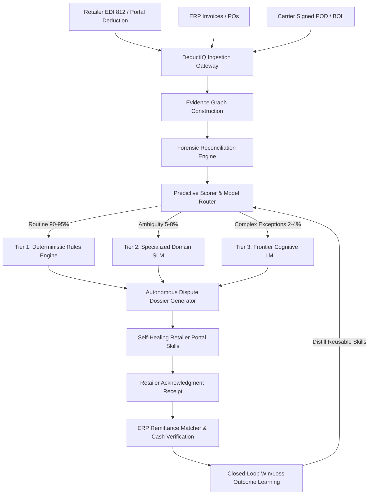

# DeductIQ — The Autonomous Revenue Recovery Engine

AI-powered autonomous revenue recovery platform that helps CPG suppliers investigate, dispute, and recover retailer deductions using evidence-driven automation and AI agents.

[](https://fastapi.tiangolo.com)
[](https://python.org)
[](https://sqlite.org)
[](#)

> **Continuous Assessment Milestone — Review I: Idea Validation & Business Modeling**  
> **Course:** 23MEY06 / 23CSY06 • Entrepreneurship & Business Incubation  
> **Team Member:** Yuvaraj S — `ES24AD181`  
> **Mentor / Guide:** Ms. A. Ramyasri  
> **Centre of Excellence (CoE) Alignment:** Erode Sengunthar Engineering College  

---

## 1. Executive Summary & Problem Context

Consumer Packaged Goods (CPG) suppliers lose millions annually when enterprise retailers (Walmart, Target, Amazon, Kroger, Costco) unilaterally short-pay invoices through post-audit deductions, shortages, compliance claims, and promotion disputes.

* **2026 Industry Benchmark:** 60% of surveyed brands recover less than half of disputed dollars; 45% report invalid deduction rates exceeding 10%.
* **The Manual Bottleneck:** Cross-referencing ERP line items, WMS/TMS shipping manifests, carrier signed Proof of Delivery (POD) stamps, and closed retailer web portals takes 45–60 minutes per claim. Low-dollar claims are systematically written off.
* **The DeductIQ Solution:** An autonomous end-to-end B2B revenue recovery worker that fuses documentary evidence into an **Evidence Graph**, executes deterministic forensic line reconciliation, scores recovery probability, routes to specialized models (Tier 1 Rules → Tier 2 SLM → Tier 3 Frontier LLM), compiles formal UCC § 2-606 legal rebuttals, executes self-healing disputes across retailer portals, and verifies cash settlements in the supplier's ERP.

---

## 2. Technical Architecture & Novelty Innovations



1. **Multi-Source Evidence Graph:** Binds Deduction ↔ Invoice ↔ Purchase Order ↔ Bill of Lading ↔ Signed POD ↔ Trade Agreements.
2. **Outcome-Aware Agent Loop:** 6-Stage Autonomous Lifecycle: *Investigate → Decide → Act → Verify → Recover → Learn*.
3. **Self-Healing Portal Skills:** When retailer portals mutate DOM selectors or reorder buttons, the agent triggers semantic vision fallback, executes the action, sandbox-replays, and promotes the fix to the skill library.
4. **Cognitive Model Router:** Deterministic rules handle 90%+ of routine claims at zero token cost, maintaining sub-$0.02 cost per case and defensible unit economics.

---

## 3. Quickstart & Installation Guide

### Prerequisites
* Python 3.10 or higher
* Modern web browser (Chrome, Edge, Firefox, Safari)

### 1. Clone & Enter Project Directory
```bash
git clone https://github.com/Yuvaraj01-tech/deductiq.git
cd deductiq
```

### 2. Set Up Virtual Environment (Recommended)
```bash
python -m venv venv
# Windows:
.\venv\Scripts\activate
# Linux/macOS:
source venv/bin/activate
```

### 3. Install Dependencies
```bash
pip install -r requirements.txt
```

### 4. Configure Environment Variables
Copy `.env.example` to `.env`:
```bash
cp .env.example .env
```
*(On Windows PowerShell: `Copy-Item .env.example .env`)*

### 5. Initialize Database & Seed Benchmark Data
```bash
cd backend
python database.py
python seed_data.py
cd ..
```
*Seeds 100 realistic benchmark CPG deductions across Walmart, Target, Amazon, Kroger, and Costco with full evidence graphs, dispute dossiers, and audit trails.*

### 6. Run the Application
```bash
cd backend
python -m uvicorn main:app --host 127.0.0.1 --port 8000
```
Open your browser and navigate to:
```
http://127.0.0.1:8000/
```
Interactive OpenAPI documentation is available at: `http://127.0.0.1:8000/docs`

---

## 4. Role-Based Access Control (RBAC) Personas

The application includes enterprise RBAC token authorization. Switch personas directly from the top-right header selector:

| Persona | Name | Role | Active Privileges | Demo Auth Token |
| :--- | :--- | :--- | :--- | :--- |
| **Admin** | Yuvaraj S | Lead Engineer | `read`, `write`, `dispute`, `approve`, `settings`, `delete` | `Bearer admin_token_sec_9918` |
| **Analyst** | Ms. A. Ramyasri | Recovery Analyst | `read`, `write`, `dispute`, `approve` | `Bearer analyst_token_sec_4421` |
| **Auditor** | External CPG Auditor | Auditor | `read` (Enforces 403 on mutations) | `Bearer auditor_token_sec_1102` |

---

## 5. Comprehensive Automated Test Suite

A 54-point end-to-end production audit test suite is included in `backend/test_production_audit.py`:

```bash
python backend/test_production_audit.py
```

### Test Coverage Checklist (100% Passed):
* [x] **Application & Backend Startup:** `/api/health`, `/` root serving.
* [x] **Frontend Assets:** CSS stylesheet & ES6 JS controller delivery.
* [x] **Database & Migrations:** SQLite WAL mode, foreign keys, schema migrations tracking.
* [x] **Authentication & Personas:** Bearer token session extraction across 3 roles.
* [x] **Authorization & RBAC:** Rejection with 403 Forbidden for unauthorized mutation attempts.
* [x] **Dashboard Metrics:** Aggregation, retailer breakdown, code breakdown, ROI multiplier.
* [x] **Claims CRUD:** Create, Read, Update, Delete with database cascade.
* [x] **Forensic Reconciliation:** Mathematical line item verification and POD dock exceptions.
* [x] **Predictive Scorer & Router:** Win probability calculation and Tier 1 Rule routing.
* [x] **Dispute Dossier Generator:** Legal UCC § 2-606 rebuttal notice generation.
* [x] **Autonomous 6-Stage Loop:** Automated dispute submission with acknowledgment receipt.
* [x] **Self-Healing Portal Simulator:** DOM mutation detection and healed selector resolution.
* [x] **Cash Verification:** ERP credit memo and remittance matching with 7.5% success fee.
* [x] **Search, Filter, Sort, Pagination:** Multi-parameter querying across retailers and codes.
* [x] **File Ingestion & Export:** CSV upload parsing, CSV export, and dossier TXT export.
* [x] **Integration Connectors:** Health check ping against Walmart, Target, Amazon, Kroger, Costco, ERP.
* [x] **Audit Trail:** Immutable logging of all agent and user actions.
* [x] **Error Handling:** 404 for missing records, 422 for malformed payloads.

---

## 6. Project Structure

```
.
├── .env.example                 # Configuration template
├── .env                         # Active environment file
├── requirements.txt             # Python dependencies
├── README.md                    # Project documentation
├── backend/
│   ├── main.py                  # FastAPI REST API & static file mount
│   ├── database.py              # SQLite WAL connection, migrations, indexes
│   ├── models.py                # Pydantic request/response schemas
│   ├── auth.py                  # RBAC dependencies & persona store
│   ├── agent_loop.py            # 6-Stage Autonomous Recovery Agent Loop
│   ├── forensic_engine.py       # Deterministic line item & POD reconciler
│   ├── recovery_scorer.py       # Predictive win rate & 3-tier model router
│   ├── dossier_generator.py     # Formal legal UCC § 2-606 dossier compiler
│   ├── portal_simulator.py      # Self-healing retailer portal automation
│   ├── edi_erp_connector.py     # EDI 812 CSV parser & ERP sync engine
│   ├── seed_data.py             # 100 realistic benchmark CPG deductions
│   ├── test_production_audit.py # 54-point automated test suite
│   └── deductiq.db              # SQLite production database
└── frontend/
    ├── index.html               # Semantic HTML5 enterprise application
    ├── css/
    │   └── style.css            # Dark mode, glassmorphism design system
    └── js/
        └── app.js               # Reactive state machine, RBAC & API controller
```

---

## 7. Incubation & Review Milestone Details

* **Incubation Context:** Developed as an AI software product under the incubation ecosystem of **Erode Sengunthar Engineering College**.
* **Financial Model:** Blended $50K–$100K annual SaaS platform subscription + 5–10% performance fee on incremental verified cash recoveries.
* **Novelty Protection (Milestone IV):** Evidence-linked recovery decision engine + verified self-healing portal skill compiler.
